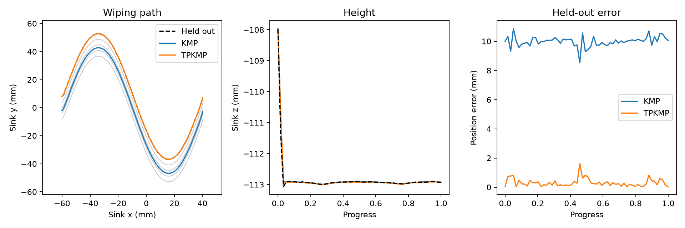

# Synthetic washbasin pilot

Five scripted simulator takes, recorded with the actual Sunrise Java recorder through the adapter on 6 November 2026. No human or real-robot demonstrations are included. The sponge follows a roughly 100 mm sinusoidal floor wipe, with small lateral offsets between takes and intermittent physical basin contact.

- `demos/wipe-01` through `wipe-05`: original measured CSV samples and captured tool XML. Only the metadata calibration path was made repository-relative when copying the raw files here.
- `models`: KMP and TP-KMP references, replayable predicted poses, comparison plot and metrics. Trained on takes 1–4; take 5 held out.

Position RMSE against take 5: **KMP 9.99 mm; TP-KMP 0.415 mm**. TP-KMP additionally receives take 5's start/end frames. This pilot checks the pipeline; it is not a fair universal ranking of the methods or evidence of real cleaning quality.



Reproduce training from the repository root:

```sh
uv run --locked scripts/train_kmp.py data/examples/sink/demos data/recordings/retrained
```

Generate another dataset with `scripts/make_demos.py`. Timing and contact forces vary with simulation/host scheduling. The scripts generate and sample physical motion; they do not simply copy commanded targets into the CSV.

See [record/replay instructions](../../../docs/demonstrations.md) and [validation](../../../docs/validation.md). Replay uses slow geometric paths, without force control or collision avoidance; begin near the first pose or check the explicit approach for clearance.
