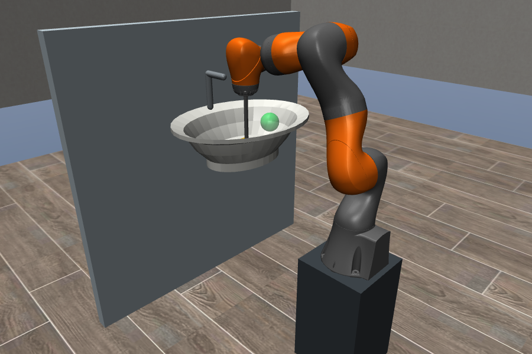

# Record, replay and learn

Commands run from the repository root. Setup is `uv run --locked scripts/setup.py`; uv manages Python and the launchers invoke Gradle for Java. New output directories must not already exist.

## Record in simulation

```sh
uv run --locked scripts/record.py data/recordings/take-01
```

1. Wait for `RECORDING` in the terminal. The arm starts where it is; recording does not command a preset posture.
2. Check **Enable hand-guiding** in the recording panel. It selects the green sphere automatically; no double-click is needed. Hold **Ctrl + Shift + right-drag** for horizontal movement, **Ctrl + right-drag** for vertical movement, or **Ctrl + left-drag** for rotation. Dragging without Ctrl moves the camera.
3. Uncheck **Enable hand-guiding**, click **Stop & save**, or press Enter to finish. The panel shows **Saved** and leaves the scene open. Use **Close simulator** when finished; closing the panel during recording saves first. Closing the MuJoCo viewer directly during an active take disconnects the recorder and leaves it incomplete. To discard a take, delete its directory yourself.

The first sample may precede enabling. Training trims stationary ends. `--seconds 10` sets a maximum duration; `--headless` hides windows; `--scene empty` selects free space.

The simulated arm follows at the recorder's guiding limits (0.3 rad/s and 100 mm/s); it does not jump to the marker. If the marker goes out of reach, bring it back. Recording saves the actual arm movement, not the marker path.

## Record on the robot

```sh
uv run --locked scripts/record.py data/recordings/lab-01 --robot --sink calibration.json
```

This uses `HRCMotions.handGuiding()` from the bundled KUKA API, with 0.3 rad/s joint and 100 mm/s Cartesian guiding limits. Use the lab's configured guiding/enabling device; releasing the guiding switch or pressing Enter ends the take. It uses the existing controller address and `EXERCISE_TOOL`, without running `goFront()` or the course gravity-compensation loop.

Before the first lab take, check the actual sponge TCP/load and hand-guiding configuration with Arne. The current XML describes the course tool. The recorder saves that XML and the active TCP, but cannot confirm the physical attachment. No hardware connection has been tested.

Simulation executes the same Java recording loop, coordinate conversion, CSV writing and completion checks. Only device/controller access is intercepted; the hardware classpath excludes the adapter. Tests cover normal stopping, replay, cancellation and a lost simulator connection. They cannot verify controller connectivity, the physical guiding switch, actual telemetry timing, or tool calibration. The first lab check should be a short recording in clear space: enable guiding, move a little, release, and inspect the saved poses/joints. Successful simulation is not a guarantee of bug-free hardware operation.

`calibration.json` contains the measured sink pose in robot-base coordinates:

```json
{"sink_pose": [0.55, 0.0, 0.4, 0.0, 0.0, 0.0, 1.0]}
```

Those numbers are the **simulator example**, not a lab calibration. Entries are XYZ in metres followed by quaternion XYZW. The pose maps sink coordinates into robot-base coordinates. Omit `--sink` for an initial logger check if needed; training requires calibration. AprilTag calibration is not implemented.

## Inspect and replay

```sh
uv run --locked scripts/inspect_demo.py data/recordings/take-01
uv run --locked scripts/replay.py data/recordings/take-01 --approach
uv run --locked scripts/replay.py data/recordings/lab-01 --robot
```

The same folder works with either backend. A real recording can be replayed in simulation without conversion, provided the simulated tool and robot-base/sink placement match it. The supplied basin pose is fixed in `simulation/scenes/sink.json`; it is not automatically repositioned from a recording.

Replay normally requires the TCP within 10 mm and about 8 degrees of the first pose. `--approach` permits a slow direct PTP approach; check its clearance, particularly around the rim. Replay rejects incomplete/malformed data and a mismatching saved TCP. It follows Cartesian poses at up to 30 mm/s, retains recorded E1 for raw takes when joint 3 was available, and uses 2 mm blending. Without recorded joint 3, it follows the tool path without a recorded elbow constraint. Waypoints are sampled at roughly 0.2 s of recorded time. **It replays the path, not original timing or forces**, and does not plan around collisions. Learned paths omit recorded joint constraints because their joint columns are placeholders.

## Try KMP and TP-KMP

```sh
uv run --locked scripts/train_kmp.py data/examples/sink/demos data/recordings/my-models
uv run --locked scripts/replay.py data/recordings/my-models/tpkmp --approach
```

The training folder contains one subdirectory per take. At least three takes are required; the last by name is held out. Outputs are a comparison plot, JSON metrics, NPZ model reference data, and replayable `kmp` / `tpkmp` folders. Nothing is automatically sent to the robot.

Both use PGLfD's existing `KMP`, with progress as input and position/orientation (`R3*SO3`) as output. We trim stationary ends, resample to 60 points, and calculate a manifold mean/covariance directly from aligned repetitions. This pilot does not need an additional GMM/GMR stage. Progress uses normalized elapsed time; it does not align substantially different movement speeds with dynamic time warping.

Here **TKMP means task-parameterized KMP (TP-KMP)**: two local KMPs in each take's start/end frames, combined by PGLfD's `TaskParameterizedModel`. Ordinary KMP uses the sink frame. TP-KMP receives the held-out start/end frames, so the comparison has different conditioning assumptions.

To generate another synthetic dataset:

```sh
uv run --locked scripts/make_demos.py data/recordings/new-sink-demos
uv run --locked scripts/train_kmp.py data/recordings/new-sink-demos data/recordings/new-models
```

These are scripted teaching targets sampled by the actual Java recorder through MuJoCo physics, not human demonstrations. The sponge makes intermittent contact; there is no pressure controller, dirt model, or cleaning-success measurement.

## Washbasin



The white basin approximates a **Villeroy & Boch O.novo 4A416101**, 600 × 460 × 175 mm with 125 mm inner depth. Its rim is 850 mm above the floor, with the robot base on a 450 mm pedestal. The bowl contour and faucet are simplified geometry, not manufacturer CAD. The sponge is a contact box around the existing TCP; tool mass/CoG remain the course values.

Sources: [manufacturer dimensions](https://pro.villeroy-boch.com/de/de/bw/p/O.novo-Lavabos-Rectangulaire--4A416101?cHash=2a4da9341c1c46a1dfa1a68163285d64), [Geberit installation-height guidance](https://www.geberit.de/badezimmerprodukte/inspirationen/tipps-tricks/die-ideale-einbauhoehe/).

## Saved format

`samples.csv` columns:

```text
t,x,y,z,qx,qy,qz,qw,j1,j2,j3,j4,j5,j6,j7,fx,fy,fz,mx,my,mz,read_seconds
```

Time is monotonic seconds; XYZ is metres in robot base; orientation is XYZW; joints are radians. Wrench is N/Nm, expressed in robot base with moment about TCP. During hand-guiding it includes the person's interaction, so it is not purely sponge pressure. `read_seconds` measures the whole sampling pass, including extra readings when due; these are sequential SDK reads, not an atomic hardware snapshot.

`metadata.json` records schema, source, completion, units/frames, active TCP when available, optional sink calibration, sample count, missed deadlines and channel availability. New takes use **schema 2**: missing optional joint/wrench cells contain `NaN`, never fake zero readings. Readers still accept schema 1. Valid timestamps and tool poses remain required. KMP uses those poses, so missing joint/force telemetry does not prevent training. A missing calibration file no longer prevents recording, but calibration must be supplied before training in sink coordinates.

`telemetry.jsonl` contains one JSON object per optional read: channel name, sample index, local read-start time, read duration and value (or null/error). Setup entries have sample `-1` and null time. Each channel is disabled for the rest of the take after its first exception, missing value, unavailable SDK method, invalid numeric value, or read exceeding 100 ms. The first slow read is retained; this is not a timeout for a permanently blocked SDK call. Disabled channels are listed in metadata and reported once in the terminal. Disk errors and lost required tool-pose/motion communication still stop the take and leave it marked incomplete.

| Rate target | Saved channels |
| --- | --- |
| 50 Hz | Measured TCP pose, joints and TCP wrench; unavailable joints/wrench become NaN |
| At most 10 Hz | Measured/external joint torques, commanded joints/TCP pose, measured flange pose, E1/Status/Turn, wrench inaccuracy, available wrench/torque SDK timestamps |
| At most 1 Hz | Joint/drive temperatures, read-only safety/enabling/operation state, mastering state, active-motion flag, program override |
| Once | Robot/controller names, joint and torque-sensor limits, active TCP offset/tool load, optional sink calibration, copies of application/connection/station files |

Pose arrays use metres and XYZW, relative to robot base unless named as an offset; temperatures use the SDK's Celsius values. SDK timestamps are an internal, system-dependent nanosecond clock and must not be treated as the local recorder clock. Static configuration copies preserve what was supplied, not proof of the active lab station. Simulator-only gaps (such as temperatures and safety services) are explicitly unavailable rather than invented.

Recording targets 50 Hz; use saved timestamps and missed-deadline counts to assess actual timing. Both data files flush at least every 0.5 s while reads return normally. Training leaves raw files unchanged and converts poses with `inverse(T_base_sink) * T_base_tcp`. Velocity/acceleration can be estimated later from the raw path and times; camera/video acquisition is not configured.

To read the implementation: `Record.java` contains setup, the loop and stopping; `RecordingTelemetry.java` lists the SDK channels and rates; `OptionalTelemetry.java` handles optional reads and their error log. Hardware motion/stop errors are deliberately outside that optional handler.

Validation details and pilot results are in [validation.md](validation.md).
