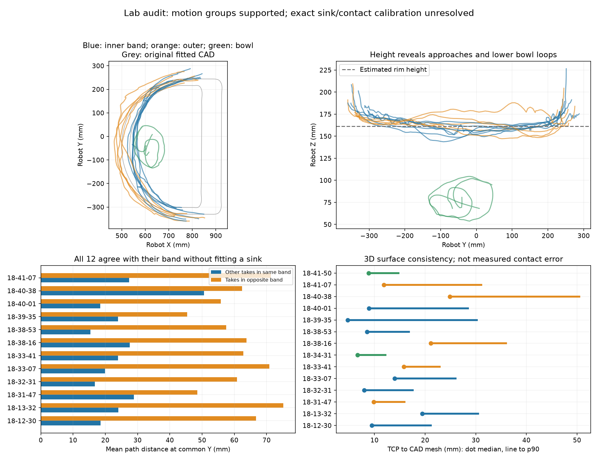

# Classification and sink-placement audit — 18 November 2026

**The motion groups are supported. The sink's general placement is supported, but its precise pose/contact calibration is not established. Some training intervals need review.**

This audit re-read the raw JSONs. It used the last six files' measured Task 11 TCP directly, instead of reconstructing all paths through the simulator. Earlier sink takes used joint FK; its agreement with the measured TCP remains sub-millimetre at the 95th percentile. No learning-model output was used to decide the labels or fit the sink.

Ala is unsure whether the sink, base or sponge attachment changed during the later takes. A fixed setup remains an assumption. No original recording, trained model, selected interval or scene placement was altered by this audit.



## Classification checks

| Check | Result | Interpretation |
|---|---|---|
| Cluster edge paths without any sink model | Two clusters reproduce all 12 inner/outer labels | Two distinct path bands are supported |
| Compare each take with the other takes, leaving itself out | All 12 are closer on average to their own band | No clear band misclassification found |
| Repeat over three overlapping Y ranges | Same grouping in all three | Grouping is not dependent on one narrow crop |
| Check recorded direction | All 12 agree with the +Y/−Y labels | Direction classes are consistent |
| Inspect the two bowl loops in 3D | Positive signed XY area; Z approximately 54–104 mm, versus edge centres near 160 mm | Counterclockwise lower-basin loops are supported |

The band comparison interpolates X/Z at shared robot-base Y; it neither fits nor translates the paths onto the CAD. Mean silhouette is 0.59. The bands also match the CAD's inner/outer boundaries better than swapping those assignments: best tested XY RMS is 18 mm versus 45 mm. This supports the physical interpretation but does not prove where the sponge touched.

The seven early files are excluded because Ala confirmed they were tests on another robot. The later wrist test stays over 150 mm above the inferred rim. The two partial/local motions do not cover a full rim sweep. Those are reasons to separate them from full-sweep training, not to call their files corrupt.

**The main classification problem is the interval selection, not which band a sweep belongs to.** Y extrema alone retain some descending approach or raised endpoints:

- `18-38-53`: selected start is about **65 mm above** its central stroke. A diagnostic height gate moves the start from **2.39 s to 3.29 s**.
- `18-32-31`: selected start is about **54 mm above** its central stroke. The same gate moves the start from **6.13 s to 8.44 s**.
- `18-40-38`: belongs to the outer band, but is unusually displaced and elevated. Its mean distance from other outer paths is about **51 mm**, compared with roughly **17–27 mm** for the other outer takes. A different setup, tool contact or execution could explain it; recording failure is not established.

The 25 mm height gate is a diagnostic proposal, not a measured contact detector. The report stores candidate intervals; the baseline models still use the original intervals. Arbitrarily replacing them would conceal this uncertainty.

[All interval plots](../data/lab/2026-11-11/analysis/audit/intervals.png)

## Sink-placement checks

The original scene places the STEP bottom-origin at approximately **(712, −42, −9) mm**, yaw **89.67°**. An independently implemented refit using the full CAD rim and a different central crop gives **(713, −42, −9) mm**, yaw **89.23°**. Agreement alone is not independent calibration, since both use the same session.

The stronger check was to fit one part of the session and evaluate the other:

| Fit using | Evaluate using | Median XY rim distance | 90th percentile |
|---|---|---:|---:|
| Seven earlier joint-only edge takes | Five later measured-TCP edge takes | **11 mm** | **35 mm** |
| Five later measured-TCP edge takes | Seven earlier joint-only edge takes | **14 mm** | **33 mm** |

The first split's maximum discrepancy is 59 mm. These are distances to the assigned CAD boundary, not uncertainty bounds for the physical sink pose. This is a retrospective robustness check: the labels and central region were already chosen from the session.

The two bowl loops were **not used in rim fitting**. Against the original scene, their median distance to the actual 3D CAD triangle surface is approximately **7 mm and 9 mm** (90th percentiles 12 mm and 15 mm). This separately supports the basin location and depth.

I also challenged the assumed orientation with 12 starting yaws across a full turn, and tried fitting either boundary without labels. A roughly **275°** alternative fits the edge arcs almost as well in XY (RMS 19 mm versus 17 mm near 89°), but fits the bowl loops worse (median 19 mm and 13 mm versus 7 mm and 9 mm). Thus the bowl data favors the current facing direction; the arcs alone do not establish it uniquely. Nearby yaw/translation combinations also have similar scores.

## What remains unresolved

- **Contact point versus sink height:** assuming an extra tool-Z offset of −20, 0 or +20 mm changes fitted sink-origin Z to approximately **+11, −9 or −28 mm**, while bowl distances remain similar. The recorded TCP is known; the sponge's physical contact offset/compression is not. The data cannot uniquely calibrate both.
- **Some paths miss the CAD boundary.** The displaced `18-40-38` take has a median 3D surface distance of **25 mm**, p90 **50 mm**. Several outer paths lie beyond the CAD footprint. A sponge can extend beyond the TCP, and this STEP is photo-constrained; point-to-mesh distances are not sponge penetration/contact errors.
- **Possible setup variation:** individual path fits differ by centimetres. That can result from different contact points, incomplete arcs, tool tilt or actual sink movement; it does not prove movement. Pooling all takes into one exact calibration is unjustified.
- **CAD accuracy:** matching the provided STEP does not verify that every surface matches the real washbasin.

The most useful physical check is to measure three well-separated, identifiable rim points and the sponge contact offset on the actual setup. That would distinguish a pose error from differing demonstrations. Until then, keep this as an approximate inspection scene and treat the learned paths as a preliminary baseline.

## Reproduce

```sh
uv run --locked scripts/audit_lab.py
```

[Machine-readable results](../data/lab/2026-11-11/analysis/audit/report.json) include per-file measurements, alternative fits, split membership, interval proposals and offset sensitivity. The audit writes reports/figures only. Its exact triangle-distance routine has independent interior/edge/vertex and vertical-surface checks; no convex-hull or simulator contact approximation is used for these distances.
